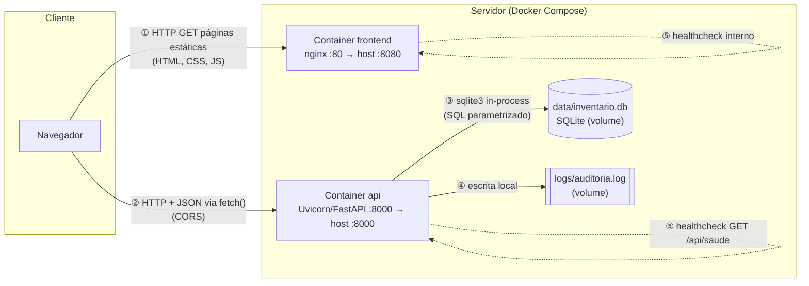

# [S3_20] Redes, Segurança, LGPD e Sustentabilidade

## 1. Análise dos mecanismos de comunicação

### 1.1 Fluxos existentes



| # | Origem → Destino | Protocolo / formato | Observações |
|---|---|---|---|
| ① | Navegador → nginx | HTTP/1.1, arquivos estáticos | Cabeçalhos de segurança: CSP, `X-Frame-Options: DENY`, `X-Content-Type-Options: nosniff`, `Referrer-Policy: no-referrer`; `server_tokens off` |
| ② | Navegador → API | HTTP/1.1, JSON (REST) | Requisição *cross-origin* (porta 8080 → 8000), liberada por CORS; erros sempre no formato `{"detail": "..."}` |
| ③ | API → SQLite | Chamada de biblioteca no mesmo processo | Uma única conexão, aberta no `lifespan`; consultas parametrizadas (`?`); `PRAGMA foreign_keys = ON` |
| ④ | API → log de auditoria | Escrita em arquivo | `INFO` só no arquivo; `WARNING` no arquivo e no console |
| ⑤ | Docker → containers | HTTP local | `GET /api/saude` a cada 30 s (API); `wget` na página inicial (frontend) |

Dois pontos de arquitetura merecem destaque:

- **Os containers não conversam entre si.** O nginx só entrega arquivos
  estáticos; quem chama a API é o navegador. Por isso o endereço da API
  (`API_URL`) precisa ser o endereço visto pelo **cliente**, e é injetado em
  `js/config.js` e na CSP (`connect-src`) ao iniciar o container
  (`frontend/nginx/40-gerar-config.sh`).
- **A API processa uma requisição por vez.** Todas as rotas são `async def` e
  a conexão SQLite é usada sempre no mesmo thread
  (`app/api/aplicacao.py`). Isso elimina condições de corrida no cache em
  memória dos serviços, mas limita a vazão a uma requisição simultânea.

### 1.2 Controles de segurança já presentes

| Ameaça | Controle implementado | Onde |
|---|---|---|
| Injeção de SQL | Consultas com parâmetros (`?`), nunca concatenação de strings | `app/repositories/*.py` |
| Dados malformados | Esquemas Pydantic (tipos, faixas) + validação de negócio (campos obrigatórios, caracteres permitidos, CVSS 0–10, soma dos fatores < 1) | `app/api/esquemas.py`, `app/services/validacao.py` |
| XSS | Dados da API inseridos com `textContent`; CSP sem `unsafe-inline`; sem scripts ou eventos inline | `frontend/public/js/ui.js`, `default.conf.template` |
| *Clickjacking* | `frame-ancestors 'none'` e `X-Frame-Options: DENY` | `default.conf.template` |
| Vazamento de detalhes internos | Exceções convertidas em mensagens controladas (`{"detail": ...}`), sem *stack trace* | `app/api/erros.py` |
| Execução privilegiada | Container da API roda como usuário sem privilégios (UID 1000) | `Dockerfile` |
| Integridade referencial | Chaves estrangeiras com `ON DELETE CASCADE`, `CHECK` nos fatores, *trigger* para vulnerabilidades órfãs | `app/repositories/database.py` |
| Rastreabilidade | Log de auditoria de toda escrita e de toda tentativa inválida | `app/logging_config.py` |

### 1.3 Fragilidades identificadas

| # | Fragilidade | Impacto | Gravidade |
|---|---|---|---|
| C1 | **Nenhuma autenticação ou autorização** na API | Qualquer um que alcance a porta 8000 lê o inventário inteiro (incluindo vulnerabilidades críticas em aberto) e pode alterar ou excluir dados | Crítica |
| C2 | **Tráfego em HTTP sem TLS** (fluxos ① e ②) | Nomes de responsáveis e a lista de vulnerabilidades trafegam em texto claro; um atacante na rede pode ler ou modificar as respostas | Alta |
| C3 | Portas publicadas em **todas as interfaces** (`"8000:8000"`, `"8080:80"`) | A API fica exposta diretamente, sem um proxy reverso na frente | Alta |
| C4 | **CORS tratado como se fosse controle de acesso** | CORS só restringe navegadores; `curl`, scripts e o Postman ignoram a política. `allow_methods=["*"]` e `allow_headers=["*"]` também são mais amplos que o necessário | Média |
| C5 | Documentação interativa (`/docs`, `/openapi.json`) aberta | Entrega a um atacante o mapa completo da API e permite executar qualquer rota pelo navegador | Média |
| C6 | Sem limite de taxa nem de tamanho de requisição | Como a API processa uma requisição por vez, uma rajada de chamadas (ou cálculos de risco repetidos) degrada o serviço para todos | Média |
| C7 | API sem cabeçalhos de segurança próprios (HSTS, `nosniff`) | Defesa em profundidade depende só do nginx do frontend | Baixa |
| C8 | Log de auditoria registra **o quê**, mas não **quem** | Sem identidade do autor, o log não serve como prova de responsabilidade | Média (passa a Alta após C1) |

### 1.4 Arquitetura de comunicação recomendada

1. **Proxy reverso com TLS na mesma origem.** Colocar um único nginx (ou
   Caddy) na frente, escutando apenas 443, servindo o frontend em `/` e
   encaminhando `/api/` para o container da API pela rede interna do Docker.
   Isso:
   - criptografa os fluxos ① e ② (TLS 1.2+; HSTS);
   - torna frontend e API **same-origin**, dispensando CORS (C4) e
     simplificando a CSP (`connect-src 'self'`);
   - permite publicar a API **apenas na rede interna** (C3):
     `ports: ["127.0.0.1:8000:8000"]` ou nenhuma porta publicada.
2. **Autenticação e autorização** conforme a seção 3 (C1, C8).
3. **Desabilitar `/docs` em produção** (`FastAPI(docs_url=None,
   redoc_url=None, openapi_url=None)`) ou restringi-la ao perfil
   Administrador (C5).
4. **Limite de taxa** no proxy (`limit_req` do nginx) e `client_max_body_size`
   pequeno, já que nenhum corpo legítimo passa de poucos kB (C6).
5. **Restringir CORS** ao estritamente necessário enquanto houver origens
   diferentes: métodos `GET, POST, PUT, DELETE` e cabeçalhos
   `Content-Type, Authorization`.

---

## 2. Proposta de controle de acesso baseada no menor privilégio

### 2.1 Princípios adotados

- **Negar por padrão:** toda rota exige autenticação, exceto
  `GET /api/saude` (usada pelo healthcheck).
- **Menor privilégio:** cada perfil recebe só as permissões necessárias à sua
  função. Ações destrutivas ou que alteram a postura de risco ficam com
  perfis de maior responsabilidade.
- **Segregação de funções:** quem registra uma vulnerabilidade não é quem
  decide aceitá-la como risco.
- **Responsabilização:** toda ação registrada no log de auditoria passa a
  incluir o identificador do usuário.

### 2.2 Perfis (RBAC)

| Perfil | Função na organização | Justificativa do escopo |
|---|---|---|
| **Leitor** | Gestores e equipes que só consultam o inventário e os riscos | Precisa ver, nunca alterar |
| **Gestor de Ativos** | Equipe de infraestrutura | Mantém o cadastro de equipamentos e as dependências entre eles |
| **Analista de Vulnerabilidades** | Equipe de segurança | Mantém o catálogo e as associações; conduz o tratamento |
| **Gestor de Riscos** | Coordenação de segurança | Única função que pode **aceitar** um risco ou apagar registros do catálogo |
| **Auditor** | Controle interno / encarregado de dados | Lê dados e o log de auditoria; não altera nada |
| **Administrador** | Responsável técnico pelo sistema | Gerencia contas e perfis, configuração e *backups*; **não** opera o inventário no dia a dia |

### 2.3 Matriz de permissões por rota

Legenda: ✅ permitido · ❌ negado · ⚠️ permitido com restrição (ver notas).

| Rota | Leitor | Gestor de Ativos | Analista de Vuln. | Gestor de Riscos | Auditor | Admin |
|---|:-:|:-:|:-:|:-:|:-:|:-:|
| `GET /saude` (público) | ✅ | ✅ | ✅ | ✅ | ✅ | ✅ |
| `GET /equipamentos`, `/{id}`, `/{id}/vulnerabilidades*` | ✅ | ✅ | ✅ | ✅ | ✅ | ❌ |
| `POST/PUT /equipamentos` | ❌ | ✅ | ❌ | ❌ | ❌ | ❌ |
| `DELETE /equipamentos/{id}` | ❌ | ⚠️¹ | ❌ | ✅ | ❌ | ❌ |
| `GET /vulnerabilidades`, `/{id}`, `/{id}/equipamentos` | ✅ | ✅ | ✅ | ✅ | ✅ | ❌ |
| `POST /vulnerabilidades` | ❌ | ❌ | ✅ | ✅ | ❌ | ❌ |
| `PUT /vulnerabilidades/{id}` | ❌ | ❌ | ⚠️² | ✅ | ❌ | ❌ |
| `DELETE /vulnerabilidades/{id}` | ❌ | ❌ | ❌ | ✅ | ❌ | ❌ |
| `POST/DELETE /equipamentos/{id}/vulnerabilidades/{vid}` | ❌ | ❌ | ✅ | ✅ | ❌ | ❌ |
| `GET /dependencias` | ✅ | ✅ | ✅ | ✅ | ✅ | ❌ |
| `PUT/DELETE /dependencias/...` | ❌ | ✅ | ❌ | ❌ | ❌ | ❌ |
| `GET /analise-de-risco*` | ✅ | ✅ | ✅ | ✅ | ✅ | ❌ |
| Leitura de `logs/auditoria.log` | ❌ | ❌ | ❌ | ❌ | ✅ | ⚠️³ |
| `/docs`, `/openapi.json` | ❌ | ❌ | ❌ | ❌ | ❌ | ✅ |
| Gestão de usuários e perfis | ❌ | ❌ | ❌ | ❌ | ❌ | ✅ |

Notas:

1. A exclusão de um equipamento apaga em cascata as vulnerabilidades
   exclusivas dele (*trigger* `excluir_vulnerabilidades_orfas`). Por isso o
   Gestor de Ativos só pode excluir equipamentos **sem** vulnerabilidades
   exclusivas (verificável por `GET /equipamentos/{id}/vulnerabilidades-exclusivas`);
   nos demais casos, a exclusão exige o Gestor de Riscos.
2. O Analista pode mudar o status para `ABERTA`, `EM_TRATAMENTO` ou
   `CORRIGIDA`, mas **não** para `ACEITA_COMO_RISCO`. Essa transição é a
   decisão de conviver com a vulnerabilidade e fica com o Gestor de Riscos
   (segregação de funções).
3. O Administrador acessa o arquivo de log apenas para manutenção
   (rotação, *backup*); a leitura para fins de auditoria é do Auditor.

O Administrador **não** recebe leitura dos dados de negócio por padrão:
gerenciar contas não exige conhecer as vulnerabilidades em aberto. Se a mesma
pessoa acumular as duas funções, ela recebe dois perfis, e a separação fica
visível no log.

**Refinamento opcional (ABAC):** restringir o Gestor de Ativos aos
equipamentos do próprio setor (atributo `setor` do equipamento comparado ao
setor do usuário), útil em organizações com várias equipes de infraestrutura.

### 2.4 Implementação sugerida na API

A arquitetura em camadas facilita a mudança: a autorização entra só na
camada `api`, como uma dependência do FastAPI, sem tocar em `services` nem
em `repositories`.

```python
# app/api/autorizacao.py (esboço)
from fastapi import Depends, HTTPException, status

PERMISSOES_POR_PERFIL = {
    "leitor": {"equipamentos:ler", "vulnerabilidades:ler", "dependencias:ler", "risco:ler"},
    "gestor_de_ativos": {"equipamentos:ler", "equipamentos:escrever", "dependencias:ler",
                         "dependencias:escrever", "vulnerabilidades:ler", "risco:ler"},
    # ... demais perfis conforme a matriz 3.3
}

def exigir(permissao: str):
    async def verificar(usuario: Usuario = Depends(usuario_autenticado)) -> Usuario:
        if not any(permissao in PERMISSOES_POR_PERFIL[p] for p in usuario.perfis):
            raise HTTPException(status.HTTP_403_FORBIDDEN, "Permissão insuficiente.")
        return usuario
    return verificar

# Em app/api/rotas/equipamentos.py:
@rotas.post("", status_code=201)
async def cadastrar_equipamento(
    dados: EquipamentoEntrada,
    servicos: Servicos,
    usuario: Usuario = Depends(exigir("equipamentos:escrever")),
): ...
```

Demais medidas:

- **Autenticação:** preferir o provedor de identidade institucional (OIDC /
  SSO), evitando que o sistema guarde senhas. Se houver contas locais: hash
  com Argon2id, MFA para Gestor de Riscos e Administrador, e tokens de acesso
  de curta duração (≤ 15 min).
- **Auditoria com identidade:** incluir `usuario=<id>` em toda linha do log de
  auditoria. Registrar também acessos negados (403), que indicam tentativa de
  escalada de privilégio.
- **Revisão periódica de acessos:** semestral, e imediatamente na mudança de
  função ou no desligamento do colaborador.

### 2.5 Menor privilégio na infraestrutura

O mesmo princípio vale para processos e arquivos, não só para pessoas:

| Recurso | Situação atual | Proposta |
|---|---|---|
| Processo da API | Usuário não-root (UID 1000) ✅ | Manter; acrescentar `cap_drop: [ALL]`, `security_opt: [no-new-privileges:true]` e `read_only: true` (com `data/` e `logs/` como únicos volumes graváveis) |
| Processo do nginx | Imagem padrão `nginx:alpine` (mestre como root) | Usar `nginxinc/nginx-unprivileged` ou aplicar as mesmas restrições de *capabilities* |
| Arquivo `inventario.db` | Permissão padrão `644` (legível por qualquer usuário do host) | `chmod 600`, dono UID 1000; pasta `data/` com `700`. O SQLite não tem usuários próprios: a permissão do arquivo **é** o controle de acesso ao banco |
| `logs/auditoria.log` | `644` | `640`, grupo de auditoria; somente adição (`chattr +a`) quando possível |
| Rede | Portas da API e do frontend publicadas em todas as interfaces | Publicar só o proxy TLS; API acessível apenas pela rede interna do Compose |
| Coleção Postman / seed | Podem rodar contra o banco real | Usar sempre um banco separado (`CAMINHO_DO_BANCO=data/teste_postman.db`), como o README já recomenda |

---

## 3. Requisitos da LGPD aplicáveis ao sistema

### 3.1 O sistema trata dados pessoais?

Sim. A LGPD (Lei nº 13.709/2018, art. 5º, I) considera dado pessoal qualquer
informação relacionada a pessoa natural identificada ou identificável. No
sistema, isso inclui:

| Dado | Onde aparece | Natureza |
|---|---|---|
| Nome do **responsável** pelo equipamento | Coluna `equipamentos.responsavel`; linhas `INFO` do log de auditoria (`responsavel='...'`) | Dado pessoal comum de colaborador |
| Associação **pessoa ↔ setor ↔ ativos vulneráveis** | Combinação de `responsavel`, `setor` e vulnerabilidades associadas | Dado pessoal; pode expor o colaborador a constrangimento ou a ataques direcionados (engenharia social) |
| Valores digitados e recusados | Linhas `WARNING` do log (ex.: o valor inválido informado no campo `responsavel`) | Pode conter dado pessoal |
| Endereço IP dos clientes | Log de acesso do Uvicorn (saída padrão, guardada pelo Docker) | Dado pessoal (identificável) |
| *(Futuro)* Contas de usuário | Login, e-mail, perfis, histórico de ações (seção 3) | Dado pessoal |

Nenhum desses dados é **dado pessoal sensível** no sentido do art. 5º, II
(origem racial, saúde, religião, biometria etc.). Ainda assim, a lista de
vulnerabilidades em aberto é **informação de alto valor para um atacante**:
mesmo fora do escopo da LGPD, ela exige o mesmo nível de confidencialidade.

### 3.2 Agentes de tratamento

| Papel (LGPD) | No contexto do sistema |
|---|---|
| Controlador (art. 5º, VI) | A organização que usa o inventário (ex.: a UFU) |
| Operador (art. 5º, VII) | Eventual empresa contratada para hospedar ou manter o sistema |
| Encarregado (art. 41) | O encarregado de dados da organização, canal com titulares e ANPD |
| Titulares (art. 5º, V) | Os colaboradores cadastrados como responsáveis e, futuramente, os usuários do sistema |

### 3.3 Base legal

O tratamento do nome do responsável tem finalidade clara: **gestão de
segurança da informação e atribuição de responsabilidade pelos ativos**.
Bases legais cabíveis (art. 7º):

- **Órgão público** (como a UFU): art. 7º, III, combinado com o art. 23 —
  tratamento necessário à execução de competências legais e ao cumprimento
  das obrigações de segurança da informação da administração pública.
- **Organização privada:** art. 7º, IX (**legítimo interesse**), com o teste
  de balanceamento documentado (art. 10). A expectativa do colaborador de ter
  seu nome associado aos equipamentos sob sua guarda é razoável.

O **consentimento não é a base adequada**: na relação de trabalho ele não é
livre, e o colaborador não poderia revogá-lo sem inviabilizar a gestão dos
ativos.

### 3.4 Requisitos aplicáveis e situação atual

| Requisito LGPD | Dispositivo | Situação atual no sistema | Recomendação |
|---|---|---|---|
| **Finalidade e adequação** | Art. 6º, I e II | Finalidade implícita, não documentada | Declarar a finalidade no aviso de privacidade e no registro de operações |
| **Necessidade (minimização)** | Art. 6º, III | O nome completo é gravado no banco **e repetido no log** de auditoria a cada cadastro ou edição | No log, registrar só o `id` do equipamento (o nome já está no banco). Avaliar trocar o nome por um identificador funcional (matrícula ou equipe) quando a pessoa não for essencial |
| **Qualidade dos dados** | Art. 6º, V | Responsável editável via `PUT`. Porém a validação "apenas letras e espaços" **recusa nomes reais com hífen ou apóstrofo** (ex.: "Ana-Maria", "D'Ávila") | Permitir hífen e apóstrofo no campo `responsavel`; a restrição atual compromete a exatidão do dado |
| **Livre acesso e transparência** | Art. 6º, IV e VI; art. 9º | Não há aviso aos titulares | Aviso de privacidade interno informando finalidade, base legal, retenção e canal do encarregado |
| **Segurança** | Art. 6º, VII; **art. 46** | Sem autenticação, sem TLS, banco legível por qualquer usuário do host (seções 2.3 e 3.5) | Implementar as seções 2.4 e 3: **é o maior gap de conformidade** |
| **Prevenção / *privacy by design*** | Art. 6º, VIII; **art. 46, §2º** | Controles de entrada robustos, mas a segurança de acesso ficou fora do escopo | Incluir autenticação e TLS nos requisitos da próxima versão |
| **Responsabilização e prestação de contas** | Art. 6º, X | Log registra a ação, mas não o autor | Incluir a identidade do usuário no log (seção 3.4) |
| **Registro das operações de tratamento** | Art. 37 | Inexistente | Registrar no inventário de dados da organização (ROPA): dados, finalidade, base legal, retenção, compartilhamento |
| **Direitos do titular** (acesso, correção, eliminação) | Art. 18 | Correção possível via `PUT`. A eliminação é parcial: excluir ou alterar o responsável **não apaga o nome do log** nem dos *backups* | Definir a retenção do log e dos *backups*; documentar o procedimento de atendimento ao titular |
| **Término do tratamento** | Arts. 15 e 16 | Log sem rotação nem prazo; logs do Docker sem limite de tamanho | `RotatingFileHandler`/`logrotate` com prazo definido (ex.: 12 meses); `logging.options.max-size` no Compose |
| **Comunicação de incidente** | Art. 48; Resolução CD/ANPD nº 15/2024 | Sem procedimento | Plano de resposta: comunicar à ANPD e aos titulares em até 3 dias úteis quando o incidente puder gerar risco ou dano relevante. O log de auditoria ajuda a delimitar o incidente |
| **Relatório de impacto (RIPD)** | Art. 38 | Não elaborado | Não obrigatório para este volume e natureza de dados, mas recomendável se o sistema passar a guardar contas de usuários e histórico de ações |
| **Dados de teste** | Art. 6º, III | O seed usa dados fictícios ✅; a coleção Postman grava no banco e no log reais se apontada para eles | Manter testes sempre em banco separado; nunca copiar a base de produção para testes sem anonimizar |

> **Nota sobre este relatório:** a seção 5 analisa os dados reais do banco,
> mas não reproduz os nomes dos responsáveis. Para a análise bastam as
> contagens (princípio da necessidade).

---

## 4. Análise estatística dos dados

### 4.1 Fonte e limitações

- **Fonte:** cópia do banco `data/inventario.db` em 12/11/2026 (leitura sem
  alterações) e `logs/auditoria.log` (94 linhas, de 29/10 a 12/11/2026).
- **Método:** estatística descritiva. Os riscos foram calculados com o
  próprio `AnaliseDeRiscoService` da aplicação.
- **Limitação:** a amostra é pequena (n = 7 equipamentos e 7
  vulnerabilidades). Os números descrevem **este** inventário; não permitem
  inferência para outras redes nem testes de hipótese com poder estatístico.

| Entidade | Quantidade |
|---|---:|
| Equipamentos | 7 |
| Vulnerabilidades (catálogo) | 7 |
| Associações equipamento ↔ vulnerabilidade | 11 |
| Dependências entre equipamentos | 8 |
| Setores distintos | 4 |
| Responsáveis distintos | 5 |

### 4.2 Equipamentos

| Tipo (classe) | Qtde | Fator de exposição |
|---|---:|---:|
| Servidor | 2 | 1,2 |
| Firewall | 1 | 1,5 |
| Roteador | 1 | 1,3 |
| Switch | 1 | 1,1 |
| Estação de Trabalho | 1 | 1,0 |
| Impressora | 1 | 0,8 |

| Setor | Qtde | % |
|---|---:|---:|
| Sala de Telecom | 3 | 42,9% |
| Data Center Sala 1 | 2 | 28,6% |
| Recursos Humanos | 1 | 14,3% |
| Financeiro | 1 | 14,3% |

Cinco dos sete ativos (71%) são de infraestrutura central (Data Center e Sala
de Telecom). O fator de exposição médio do parque é **1,16**.

### 4.3 Vulnerabilidades: nota CVSS

Notas: 2,4 · 4,3 · 5,3 · 8,1 · 8,6 · 9,1 · 9,8

| Medida | Valor |
|---|---:|
| Média | **6,80** |
| Mediana | **8,10** |
| Desvio padrão amostral (s) | 2,80 |
| Mínimo / Máximo | 2,4 / 9,8 |
| Amplitude | 7,4 |
| 1º quartil / 3º quartil | 4,3 / 9,1 |
| Coeficiente de variação | 41% |

A **média é menor que a mediana**, o que indica uma distribuição
**assimétrica à esquerda**: a maior parte das notas está na faixa alta, e
poucas notas baixas puxam a média para baixo. Quatro das sete
vulnerabilidades têm CVSS ≥ 8,1 (a mediana).

**Severidade × status** (contagem de vulnerabilidades):

| Severidade (CVSS v3.1) | Aberta | Em tratamento | Corrigida | Aceita como risco | Total |
|---|:-:|:-:|:-:|:-:|:-:|
| Crítica (9,0–10,0) | **2** | 0 | 0 | 0 | 2 |
| Alta (7,0–8,9) | 0 | 2 | 0 | 0 | 2 |
| Média (4,0–6,9) | 0 | 0 | 1 | 1 | 2 |
| Baixa (0,1–3,9) | 1 | 0 | 0 | 0 | 1 |
| **Total** | 3 | 2 | 1 | 1 | 7 |

- **57%** das vulnerabilidades são de severidade alta ou crítica.
- **71%** (5 de 7) ainda não foram resolvidas (abertas ou em tratamento).
  A nota CVSS média dessas é **7,6**, acima da média geral.
- **Achado principal:** as duas vulnerabilidades **críticas estão abertas**,
  sem tratamento iniciado, enquanto as duas altas já estão em tratamento. A
  priorização observada está **invertida** em relação à severidade. A crítica
  de nota 9,8 (senha padrão de administrador) afeta dois equipamentos.

**Categorias:** Configuração Insegura (2), Software Desatualizado (2),
Autenticação (1), Criptografia (1), Proteção de Endpoint (1). Problemas de
**configuração e atualização** somam 57% do catálogo. São falhas de processo
(*hardening* e gestão de *patches*), não de produto.

### 4.4 Matriz de incidência M (equipamento × vulnerabilidade)

| Medida | Valor |
|---|---:|
| Densidade de M (11 de 49 células) | 22,4% |
| Vulnerabilidades por equipamento — média / mediana / máx. | 1,57 / 1 / 3 |
| Equipamentos por vulnerabilidade — média / mediana / máx. | 1,57 / 1 / 3 |

- O **Servidor Banco de Dados 01** concentra 3 vulnerabilidades (o máximo).
- A vulnerabilidade mais disseminada (**Firmware desatualizado**, CVSS 4,3)
  afeta 3 equipamentos: o roteador, o switch e o firewall, ou seja, **todo o
  núcleo de rede**. Ela está marcada como **aceita como risco**. Isoladamente
  a nota é média, mas a decisão de aceitá-la merece revisão, porque o efeito
  é sistêmico.

### 4.5 Dependências (matriz A)

| Medida | Valor |
|---|---:|
| Dependências cadastradas | 8 |
| Fator médio / mín. / máx. | 0,275 / 0,1 / 0,5 |
| Maior soma de linha de A | 0,6 (Servidor Web 02) — dentro do limite < 1 |
| det(I − A) | 1,0000 |
| Número de condição de (I − A) | 2,11 |

- O **Switch Core 01** é o ativo do qual mais equipamentos dependem (3), seguido
  do Firewall de Perímetro 01 (2): são pontos únicos de propagação de risco.
- O determinante é **exatamente 1** porque o grafo de dependências é
  **acíclico**. Ordenando os equipamentos topologicamente, A fica
  estritamente triangular, e o determinante de I − A é o produto da diagonal
  (todos 1). O número de condição 2,11 indica um sistema **bem
  condicionado**: a perda de precisão numérica é desprezível.

### 4.6 Risco próprio (b) e risco efetivo (x)

| Equipamento | Risco próprio b | Risco efetivo x | Herdado (x − b) | % herdado | Posição por b → por x |
|---|---:|---:|---:|---:|:-:|
| Servidor Banco de Dados 01 | 27,84 | **30,47** | 2,63 | 9% | 1º → 1º |
| Firewall de Perímetro 01 | 19,35 | **28,06** | 8,71 | 31% | 2º → 2º |
| Servidor Web 02 | 6,36 | **24,16** | 17,80 | **74%** | 5º → **3º** |
| Roteador de Borda 01 | 17,42 | 17,42 | 0,00 | 0% | 3º → 4º |
| Switch Core 01 | 4,73 | 13,15 | 8,42 | 64% | 6º → 5º |
| Estação RH 05 | 2,40 | 11,18 | 8,78 | **79%** | 7º → 6º |
| Impressora Financeiro 01 | 7,84 | 9,15 | 1,32 | 14% | 4º → **7º** |
| **Total** | **85,94** | **133,59** | **47,65** | **35,7%** | |

| Estatística | b | x |
|---|---:|---:|
| Média | 12,28 | 19,08 |
| Mediana | 7,84 | 17,42 |
| Desvio padrão amostral | 9,38 | 8,52 |

- **35,7% do risco total vem das dependências.** Sem a matriz A, o
  inventário subestimaria o risco em mais de um terço.
- As dependências **reduzem a dispersão** (s cai de 9,38 para 8,52) e elevam
  a mediana de 7,84 para 17,42: o risco se espalha pela rede.
- A correlação entre b e x é **forte, mas não perfeita**: Pearson
  r = 0,77 e Spearman ρ = 0,71. O ranking muda de forma relevante. O
  **Servidor Web 02** sobe do 5º para o 3º lugar, com 74% de risco herdado
  (depende do Servidor BD e do Firewall). A **Estação RH 05** tem risco
  efetivo 4,7 vezes maior que o próprio.
- O **Roteador de Borda 01** não depende de nenhum ativo (x = b), mas é a
  origem da cadeia: o Firewall herda metade do risco efetivo dele (fator 0,5)
  e repassa parte ao Switch e ao Servidor Web.

### 4.7 Análise de sensibilidade: status das vulnerabilidades

O modelo atual monta **M com todas as associações, independentemente do
status**. Uma vulnerabilidade `CORRIGIDA` continua somando ao risco. O caso
mais visível é o Servidor Web 02: sua única vulnerabilidade (certificado TLS
expirado) já está corrigida, e mesmo assim ele aparece com b = 6,36.

Recalculando o modelo com filtros por status:

| Cenário | Risco efetivo total | Variação | Servidor Web 02 (b → x) |
|---|---:|---:|:-:|
| Atual (todas as associações) | 133,59 | — | 6,36 → 24,16 |
| Sem `CORRIGIDA` | 116,54 | −12,8% | 0,00 → 15,26 |
| Sem `CORRIGIDA` e sem `ACEITA_COMO_RISCO` | 86,76 | −35,1% | 0,00 → 12,81 |

**Recomendação:** desconsiderar as vulnerabilidades `CORRIGIDA` ao montar M
(ou ponderar por status), para que o indicador reflita o risco **residual**.
Nos dois cenários filtrados, o Servidor Web 02 continua com risco relevante
apenas por herança, o que confirma o valor do modelo de dependências.

### 4.8 Log de auditoria

| Nível | Linhas | % |
|---|---:|---:|
| INFO (ações concluídas) | 75 | 79,8% |
| WARNING (tentativas recusadas) | 19 | 20,2% |

Ações mais frequentes: vulnerabilidade atribuída (15), vulnerabilidade
cadastrada (11), dependência salva (11), análise de risco calculada (11),
equipamento cadastrado (10).

Composição dos 19 avisos: 7 buscas por ID inexistente, 5 requisições
recusadas pelo esquema (tipo ou campo inválido), 5 validações de negócio
recusadas, 1 associação duplicada e 1 exclusão de dependência inexistente.
Quase todos vêm da execução da coleção Postman (ids `999999999`, nomes
"Postman ..."), o que mostra que **testes e uso real estão no mesmo log**.
Isso reforça a recomendação de usar banco e log separados para testes: em uma
auditoria real, esses registros dificultariam distinguir tentativa de ataque
de teste automatizado.

---

## 5. Sustentabilidade e impacto ambiental

### 5.1 O que o projeto já faz bem

| Decisão de projeto | Efeito ambiental |
|---|---|
| **SQLite** em vez de um servidor de banco (PostgreSQL, MySQL) | Nenhum processo de banco ocioso consumindo memória e CPU 24 h por dia; o banco é um arquivo de 32 kB |
| **Frontend sem framework e sem etapa de *build*** | Cerca de 104 kB de HTML, CSS e JS no total; nada de `node_modules` nem *bundler* no ciclo de desenvolvimento; menos dados transferidos a cada acesso |
| **Visual feito só com CSS**, sem imagens | Menos bytes trafegados e armazenados |
| **Sem *polling*** no frontend | O navegador só chama a API quando o usuário age; não há requisições periódicas em segundo plano |
| **Cache em memória** nos serviços | Leituras de equipamentos e vulnerabilidades não acessam o disco |
| Imagens Docker enxutas (`python:3.13-slim`, `nginx:alpine`) | Imagens de 294 MB (API, dos quais boa parte é o NumPy) e 74 MB (frontend): menos armazenamento e transferência em cada implantação |
| `prefers-reduced-motion` respeitado | Desliga as animações para quem pede (benefício de acessibilidade, com economia marginal de energia no cliente) |

### 5.2 Pontos de melhoria

1. **Animações contínuas.** O tema "Wired" tem seis animações `infinite`
   (varredura, cursores piscando, dois *glitches*, pulsação). Como animam só
   `transform` e `opacity`, são baratas, mas mantêm o compositor da GPU acordado enquanto
   a aba estiver visível. Em uma ferramenta que fica aberta o dia inteiro, vale
   oferecer um botão para desligá-las, ou pausá-las com
   `animation-play-state: paused` após alguns segundos sem interação.
2. **Recalcular o risco a cada `GET`.** A análise é refeita a cada consulta
   (11 vezes no log analisado). Para n = 7 o custo é desprezível, mas o custo
   de `solve` cresce com O(n³). Guardar o resultado e invalidá-lo só quando
   equipamentos, vulnerabilidades ou dependências mudarem elimina o trabalho
   repetido.
3. **Integração contínua.** O *workflow* sobe **4 máquinas virtuais** a cada
   *push* e *pull request* (black, flake8, pylint, testes), cada uma
   instalando o Python e as dependências do zero. Melhorias: cache do `pip`
   (`actions/setup-python` com `cache: pip`), juntar os três linters em um
   único *job* e usar `paths-ignore` para não rodar a CI em mudanças só de
   documentação (como este relatório).
4. **Retenção de logs.** O log de auditoria e os logs do Docker crescem sem
   limite. A rotação com prazo atende **ao mesmo tempo** à LGPD (seção 4.4) e
   ao consumo de armazenamento e *backups*.
5. **Disponibilidade 24/7.** O requisito de ficar no ar continuamente
   (`restart: unless-stopped`) é o que mais pesa no consumo de energia, mais
   que qualquer otimização de código. Hospedar em uma máquina já compartilhada
   (VM ou servidor da instituição) evita um equipamento dedicado e ocioso na
   maior parte do tempo.

### 5.3 Estimativa da pegada de carbono

Por falta de medição, a pegada não pode ser calculada com precisão, mas a
metodologia é simples:

```
Energia anual (kWh) = Potência média atribuível (W) × 8.760 h ÷ 1.000
Emissões (kg CO₂e)  = Energia anual × fator de emissão da rede (kg CO₂e/kWh)
```

**Exemplo ilustrativo (valores hipotéticos):** uma fatia de 10 W de um
servidor compartilhado, ligada o ano todo, consome cerca de 88 kWh/ano. Com
um fator de emissão da ordem de 0,05 kg CO₂e/kWh, isso dá cerca de 4 kg
CO₂e/ano. Para o cálculo real, usar a potência medida no servidor e o fator
médio anual do Sistema Interligado Nacional publicado pelo MCTI, que varia
de ano para ano conforme o uso de termelétricas. A matriz elétrica
brasileira, predominantemente renovável, torna a pegada operacional deste
sistema muito pequena.

Para esse porte de sistema, **o impacto relevante não está na operação, mas
no hardware**. O ciclo de vida dos equipamentos (fabricação e descarte)
domina a pegada. Isso leva ao ponto seguinte.

### 5.4 O inventário como ferramenta de sustentabilidade

Um inventário de ativos é também um instrumento de gestão ambiental:

- **Prolongar a vida útil.** Saber o que existe, onde está e em que estado
  evita compras duplicadas e permite redistribuir equipamentos ociosos.
- **Descarte correto.** A Política Nacional de Resíduos Sólidos (Lei nº
  12.305/2010) e o Decreto nº 10.240/2020 estabelecem a logística reversa de
  eletroeletrônicos. Sugere-se acrescentar ao cadastro campos como data de
  aquisição, fim do suporte do fabricante e destino no descarte.
- **Tensão entre segurança e sustentabilidade.** A vulnerabilidade
  "Firmware desatualizado", aceita como risco em todo o núcleo de rede (seção
  5.4), ilustra o dilema: equipamentos sem atualização do fabricante são
  candidatos à substituição por segurança, mas trocá-los cedo aumenta o lixo
  eletrônico. O modelo de risco do sistema ajuda a decidir com dados: trocar
  primeiro os ativos cujo risco efetivo (próprio e herdado) justifica o
  impacto ambiental da substituição, e mitigar os demais com controles
  compensatórios (segmentação de rede, ACLs).

---

## 6. Síntese das recomendações

| Prioridade | Recomendação | Seções | Esforço |
|---|---|---|---|
| 1 | Autenticação + autorização por perfis (RBAC), com o usuário registrado no log de auditoria | 2.3 (C1, C8), 3, 4.4 | Médio |
| 2 | Proxy reverso com TLS na mesma origem; API sem porta pública | 2.3 (C2, C3, C4), 2.4 | Baixo |
| 3 | Iniciar o tratamento das duas vulnerabilidades **críticas abertas** e revisar a aceitação do firmware desatualizado | 5.3, 5.4 | Operacional |
| 4 | Permissões de arquivo restritas para `data/` e `logs/`; endurecimento dos containers | 3.5 | Baixo |
| 5 | Minimizar dados pessoais no log; rotação e retenção de logs e *backups* | 4.4, 6.2 | Baixo |
| 6 | Desconsiderar vulnerabilidades corrigidas no modelo de risco | 5.7 | Baixo |
| 7 | Desabilitar `/docs` em produção; limite de taxa | 2.3 (C5, C6) | Baixo |
| 8 | Documentação LGPD: aviso de privacidade, registro de operações, plano de incidentes | 4.4 | Médio (administrativo) |
| 9 | Aceitar hífen e apóstrofo no nome do responsável | 4.4 | Baixo |
| 10 | Cache da análise de risco, otimização da CI, controle das animações | 6.2 | Baixo |

---

## 7. Referências

- BRASIL. **Lei nº 13.709, de 14 de agosto de 2018.** Lei Geral de Proteção
  de Dados Pessoais (LGPD).
- AUTORIDADE NACIONAL DE PROTEÇÃO DE DADOS. **Resolução CD/ANPD nº 15, de 24
  de abril de 2024.** Regulamento de Comunicação de Incidente de Segurança.
- BRASIL. **Lei nº 12.305, de 2 de agosto de 2010.** Política Nacional de
  Resíduos Sólidos.
- BRASIL. **Decreto nº 10.240, de 12 de fevereiro de 2020.** Logística
  reversa de produtos eletroeletrônicos de uso doméstico.
- FIRST. **Common Vulnerability Scoring System v3.1: Specification
  Document.**
- OWASP. **Application Security Verification Standard (ASVS) 4.0** —
  capítulos V1 (Arquitetura), V4 (Controle de Acesso) e V9 (Comunicação).
- ABNT. **NBR ISO/IEC 27002:2022** — Controles de segurança da informação
  (5.15 Controle de acesso; 5.18 Direitos de acesso; 8.2 Direitos de acesso
  privilegiado).
- GREEN SOFTWARE FOUNDATION. **Software Carbon Intensity (SCI)
  Specification** (ISO/IEC 21031:2024).
- Documentação do projeto: `README.md`, `Especificacao_Consolidada.md`,
  `frontend/README.md`.
